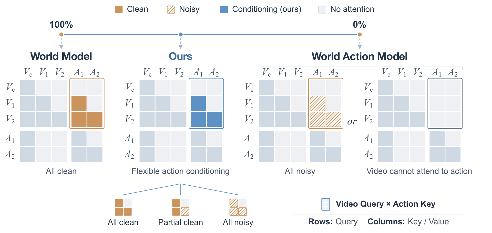
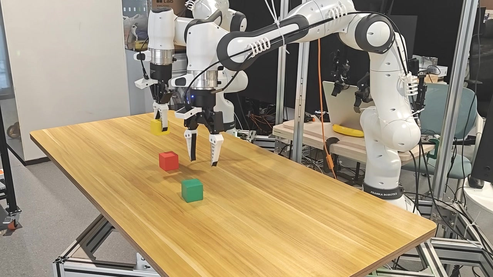
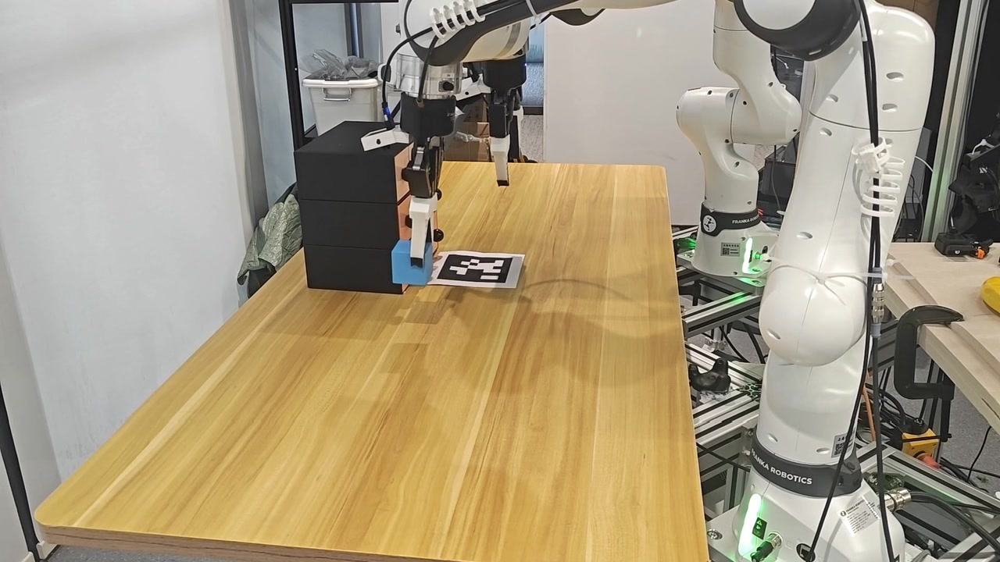
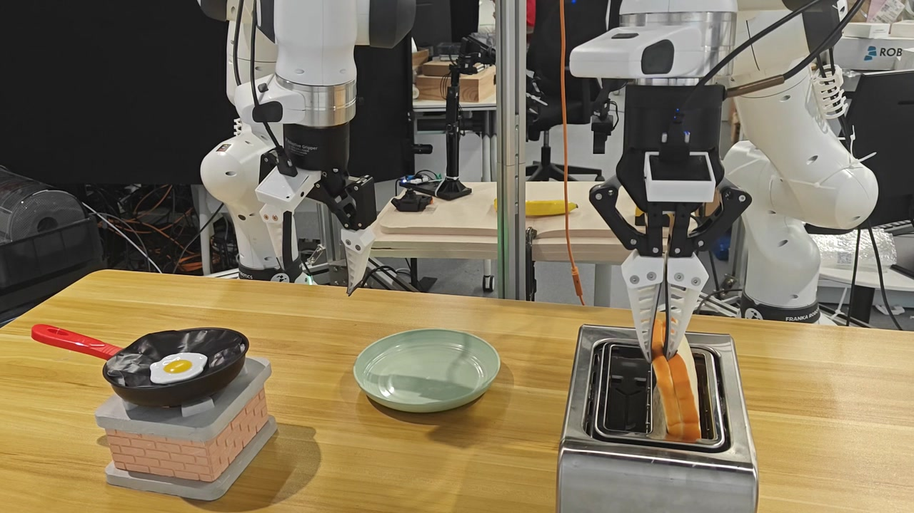
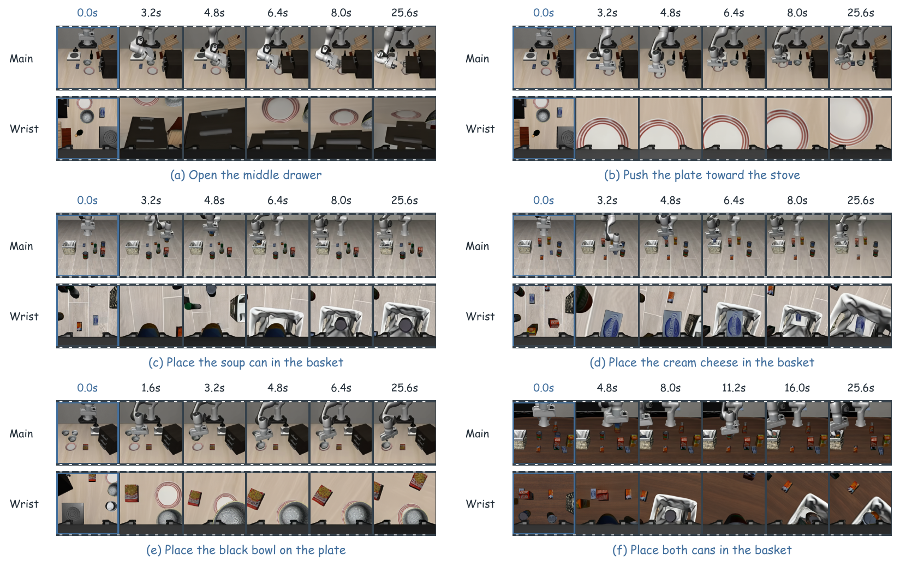

<div align="center">

# OneWM

### Can World and Action Modeling Benefit Each Other<br>under Unified Causal Training?

Yue Su*, Bokai Lin*, Xinkai Wang*, Chubin Zhang, Xiangnan Wu, Kuan Zhang,<br>
Weiyang Jin, Jiwen Yu, Yiming Li, Cewu Lu, Lixin Yang†, Xihui Liu†

MMLab@HKU · MVIG@SJTU · THU · SII · UCAS · IAAI Team<br>
<sub>* Equal contribution. † Corresponding authors.</sub>

**[Project Page](https://selen-suyue.github.io/OneWMNet/) · [Paper](assets/OneWM-preview.pdf) · [Demos](https://selen-suyue.github.io/OneWMNet/#experiments)**

**Code coming soon.**

[Original full-resolution PDF](assets/OneWM.pdf)

</div>

## Overview

**One causal model learns to predict the world and act in it.**

OneWM is a simple framework for unified causal training of world prediction and action generation. Within a shared video–action architecture, actions serve as both **conditions for predicting visual consequences** and **targets for policy learning**. We study whether these two learning objectives can benefit each other while keeping the architecture fixed.

Our experiments on **LIBERO, LIBERO-Plus, RoboCasa365, and real robots** support reciprocal benefits: learning action-conditioned forward dynamics improves policy performance and generalization, while action learning improves multi-view world-prediction fidelity.

## How it works

<p align="center">
  
</p>

OneWM connects world modeling and action generation by varying how much of the action sequence is known. A shared video–action architecture with **temporally causal attention** learns from three conditioning regimes:

- **All-clean:** specified actions condition future-video prediction.
- **Partial-clean:** a clean action prefix conditions future-video prediction and denoising of the remaining action suffix.
- **All-noisy:** the model learns to generate actions alongside future video.

At inference, the same model supports action generation from observations and instructions, or world prediction conditioned on specified actions.

## Real-world manipulation

| Block stacking | Block insertion | Breakfast arrangement |
| :---: | :---: | :---: |
| [](assets/demos/stacking.mp4) | [](assets/demos/storage.mp4) | [](assets/demos/breakfast.mp4) |

Click a preview to open its silent video, or [watch all three on the project page](https://selen-suyue.github.io/OneWMNet/#experiments).

## An Endless Dream

> **After the first observation, OneWM sees only what it imagines.**

Starting from an initial pair of camera views and a task instruction, OneWM **predicts an action chunk**, holds those predicted actions fixed to **imagine the next video**, then feeds the final generated views back into its next action prediction. The same model repeats this loop with **no further environment observations** and no additional training.

<p align="center">
  <a href="https://selen-suyue.github.io/OneWMNet/#dreaming"></a>
</p>

The shown LIBERO rollouts span **16 rounds, 512 predicted actions, and 25.6 seconds of modeled time**. They demonstrate task-directed progression in imagination; the generated action sequences are not executed in the simulator in this demonstration.

[Explore the interactive action-and-video loop](https://selen-suyue.github.io/OneWMNet/#dreaming) · [Watch a sample rollout](assets/demos/endless-dream.mp4)

## Release status

- [x] Paper and project page
- [x] Selected demonstration videos
- [ ] Code release — coming soon

## Citation

If you find this work useful, please cite:

```bibtex
@misc{su2026onewm,
  title  = {Can World and Action Modeling Benefit Each Other under Unified Causal Training?},
  author = {Yue Su and Bokai Lin and Xinkai Wang and Chubin Zhang and Xiangnan Wu and Kuan Zhang and Weiyang Jin and Jiwen Yu and Yiming Li and Cewu Lu and Lixin Yang and Xihui Liu},
  year   = {2026},
  url    = {https://github.com/Interactive-Active-AI/OneWM}
}
```
